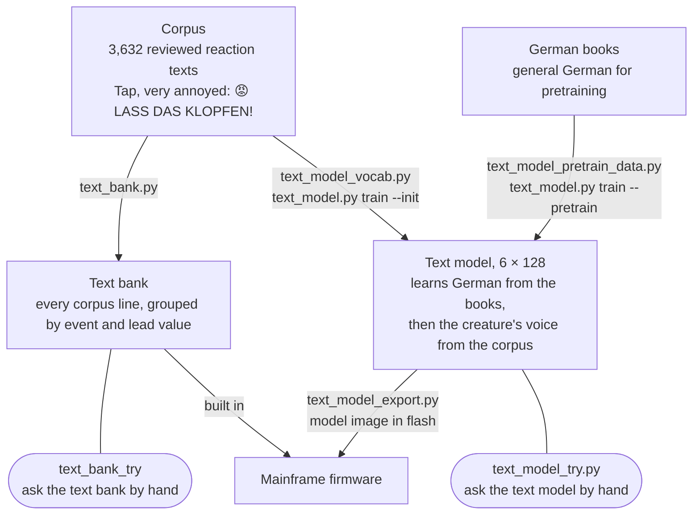
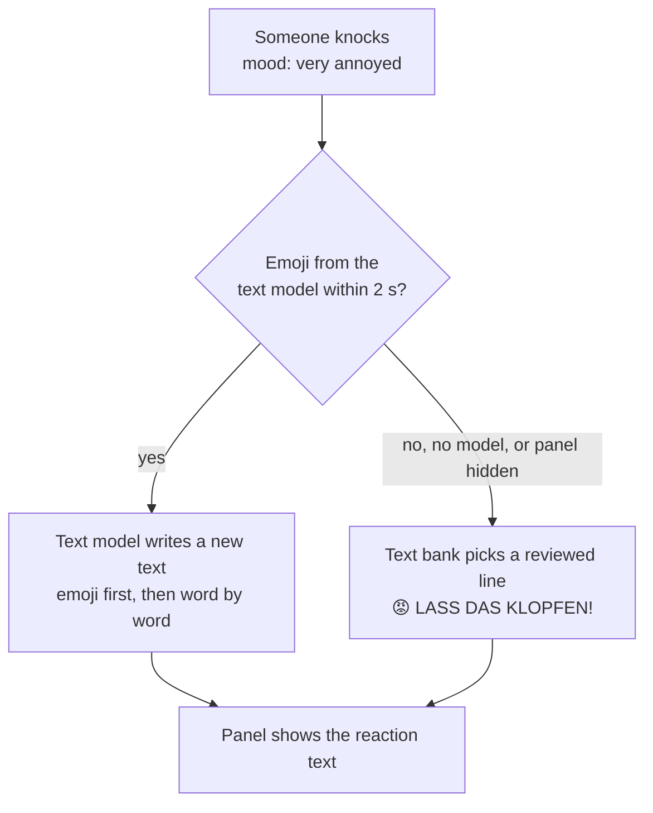

# Decaflash V2

Independent, offline-capable light installation with an AtomS3R Mainframe, Atomic Voice Base and M5Atom Nodes. The original Decaflash project and its hardware remain independent; V2 has its own Mainframe and Node sources.

## Status

The Mainframe processes Voice Base audio for tempo (BPM) and the iris VU, controls scenes and clock over ESP-NOW and shows an interactive low-poly eye. The show clock adopts the confirmed tempo of the PCM tempo tracker; its hardware acceptance is pending. Local personality and motion logic influence the eye and the Node output. The Unit TMOS PIR presence sensor drives the attention base, loneliness and presence events with texts (presence debug screen and `TMOS` serial lines for checking). The Node firmware supports flashlight and RGB output.

V2 uses its own radio identity `DCF2` (`0x44434632`). The host tests check the separation of V1 and V2 for all protocol packets.

## Orientation

| Location | Content |
| --- | --- |
| [apps/mainframe/src](apps/mainframe/src) | AtomS3R Mainframe |
| [apps/node/src](apps/node/src) | M5Atom Node firmware |
| [shared/include](shared/include) | Protocol, transport and scenes |
| [docs/project-context.md](docs/project-context.md) | Project context: history, code analysis, plans and open decisions |
| [bugs.md](bugs.md) | Known defects in code and documentation |
| [openspec/](openspec) | OpenSpec specs (`specs/`), changes (`changes/`) and project context (`config.yaml`) |
| [workers/decaflash/README.md](workers/decaflash/README.md) | Optional cloud Worker |
| [CLAUDE.md](CLAUDE.md), [.claude/settings.json](.claude/settings.json) | Working rules and permissions |

## Local commands

From the repository root, with PlatformIO installed:

```bash
pio run -e mainframe
pio run -e node
sh tests/run_all.sh
```

The Mainframe builds for the AtomS3R; the Node for `m5stack-atom` with FastLED 3.10.3. `tests/run_all.sh` runs all host tests under `tests/`; individual tests run via their respective `tests/run_*.sh`. A successful build or host test does not replace a device check.

`mainframe-slm` is the Mainframe with the text model runtime (`add-text-model`, trial build before the move into `mainframe`). It uses `apps/mainframe/partitions_slm.csv` without a second app slot; the model image is written separately to the model partition at 0x340000:

```bash
pio run -e mainframe-slm -t upload
<platformio-python> ~/.platformio/packages/tool-esptoolpy/esptool.py --chip esp32s3 write_flash 0x340000 models/text-model/<image>.bin
```

`<platformio-python>` is the Python that runs PlatformIO (the first line of `which pio`), because it has `pyserial`. Without an image every reaction text comes from the text bank, with a wine-red frame. Each model text prints a `TEXT` line on the serial port (times from the event to the emoji, the first word and the end, the seed and the text), and each fallback to the text bank a `TEXT fallback` line. `apps/mainframe/tools/text_model_write.cpp` writes the text for a given condition and seed on the Mac for comparison. Flash `mainframe` again to return to the normal partition table.

Measurement-only environments are described by their comments in `platformio.ini`. `mainframe-slm-capture` belongs to the language model prototype ([docs/slm-prototype.md](docs/slm-prototype.md)); it uses its own partition table without a second app slot, so flash `mainframe` again after measuring. The `slm-bench-*` environments build a benchmark that contains only the model kernel and is not a Mainframe firmware.

List serial devices and monitor a confirmed port:

```bash
pio device list
pio device monitor -e mainframe --port <PORT>
pio device monitor -e node --port <PORT>
```

Local configuration stays outside Git:

- `include/wifi_credentials.h`, template: `include/wifi_credentials.example.h`
- `include/cloud_config.h`, template: `include/cloud_config.example.h`
- Worker secrets: see the [Worker README](workers/decaflash/README.md)

## Text model and text bank (host)

The reaction texts come from the reviewed corpus in `apps/mainframe/text_model/corpus/` (text bank: [spec](openspec/specs/text-bank/spec.md); text model: [add-text-model](openspec/changes/add-text-model)). Everything below runs on the Mac from the repository root. Models, images and helper binaries go to the ignored `models/text-model/`.

Terms (use these words in code, docs, specs and chat; German in brackets):

| Term | Meaning |
|---|---|
| corpus (Korpus) | The reviewed lines in `apps/mainframe/text_model/corpus/*.tsv`, each with event, five mood levels, emoji and words. The only source of reaction texts. |
| plan (Plan) | `apps/mainframe/text_model/plan/*.tsv`: the lead value and levels each corpus line was written for. |
| text bank (Textbank) | The corpus lines built into the firmware plus the rule that picks one line for an event and mood, without a model ([spec](openspec/specs/text-bank/spec.md)). Never the corpus files themselves. |
| text model (Textmodell) | Our own small generative model that writes a new reaction text; trained on the corpus (`add-text-model`). |
| language model prototype (Sprachmodell-Prototyp) | The earlier device trial with the reference model Barista ([docs/slm-prototype.md](docs/slm-prototype.md)). Not the text model. |
| reaction text (Reaktionstext) | A text the panel shows for a motion or presence event, whatever its source. |
| fixed texts (feste Texte) | The 32 texts built into today's firmware; they are part of the corpus. |
| event (Ereignis) | One of the twelve text events: Move, Tap, double tap, MultiTap with three or more taps, Impact, Rotate, Reposition, Shake, `Kommt davor`, `Läuft vorbei`, `Geht weg`, `Steht weiter weg`. |
| mood value (Stimmungswert) | One of energy, annoyance, attention, loneliness, depression, 0–100. |
| mood level (Stufe) | The low, middle or high third of a mood value. |
| lead value (Leitwert) | The one mood value, at low or high, that a corpus line was written for and that the text bank picks by. |
| token (Token) | One unit the text model reads or writes: a word, a punctuation mark, an emoji, or a control token (start, end, event, mood level). The older word "piece" meant the same. |
| checkpoint (Checkpoint) | A trained text model on the Mac (`.pt`). |
| model image (Modell-Image) | The exported 4-bit file the device loads (`.bin`). |
| pretraining (Vortraining) | Optional training on other German text before the corpus; measured, not used in the current text model. |
| rating (Bewertung) | The user's judgement of 30 texts for fixed cases. |

From the corpus to the device (on the Mac), as the goal:



What the Mainframe does at every event (the goal):



The normal `mainframe` build uses the text bank for every reaction text; the text model runs only in the trial build `mainframe-slm` (groups 7 to 9 of `add-text-model`).

Python packages, once (hash-pinned PyTorch and NumPy):

```bash
python3 -m venv .venv-text-model
.venv-text-model/bin/python -m pip install --require-hashes --only-binary :all: -r apps/mainframe/tools/text_model_requirements.txt
```

Check the corpus (levels, plan, form check):

```bash
python3 -I apps/mainframe/tools/text_model_corpus.py check
```

After editing the corpus, regenerate the word vocabulary header (the host tests fail while it is stale):

```bash
python3 -I apps/mainframe/tools/text_model_vocab.py
```

Build the two host helpers (kernel and form check):

```bash
mkdir -p models/text-model/bin
c++ -std=c++17 -O2 -I apps/mainframe/src apps/mainframe/tools/text_model_generate.cpp -o models/text-model/bin/text_model_generate
c++ -std=c++17 -O2 -I apps/mainframe/src -I apps/mainframe/tools apps/mainframe/tools/text_model_form_check.cpp -o models/text-model/bin/text_model_form_check
```

Train a model (3 layers × 64, about 15 seconds), export its 4-bit image and compare the host kernel with the Python model on 60 cases (a single late difference at a close choice is expected and makes the command exit with 1):

```bash
.venv-text-model/bin/python -I apps/mainframe/tools/text_model.py train --layers 3 --dim 64 --seed 1 --steps 600 --corpus apps/mainframe/text_model/corpus --out models/text-model/try.pt
.venv-text-model/bin/python -I apps/mainframe/tools/text_model_export.py models/text-model/try.pt models/text-model/try.bin
.venv-text-model/bin/python -I apps/mainframe/tools/text_model_check.py models/text-model/try.pt models/text-model/try.bin models/text-model/bin/text_model_generate
```

Try it by hand: enter an event number (1–12, listed at the start) and five mood digits for energy, annoyance, attention, loneliness and depression (0 low, 1 middle, 2 high), for example `2` then `12111` for a knock while very annoyed; `q` ends it:

```bash
.venv-text-model/bin/python -I apps/mainframe/tools/text_model_try.py models/text-model/try.pt --image models/text-model/try.bin --generator models/text-model/bin/text_model_generate
```

Ask the text bank by hand, with the firmware's own selection code. Build it once (again after a corpus edit, after `python3 -I apps/mainframe/tools/text_bank.py`):

```bash
c++ -std=c++17 -O2 -I apps/mainframe/src apps/mainframe/tools/text_bank_try.cpp apps/mainframe/src/text_bank.cpp -o models/text-model/bin/text_bank_try
```

Then pass an event number (1–12) and five mood values 0–100 (energy, annoyance, attention, loneliness, depression); this one is a knock while very annoyed. It prints the lead value, the size of that group and three texts of the round:

```bash
models/text-model/bin/text_bank_try 2 30 90 50 40 60
```

Without arguments it asks in a loop and keeps its rounds: pick the event in a list with the arrow keys and Enter, then type the five values; `q` ends it.

The firmware uses the text bank since 2026-11-18; the text model runs only in the trial build `mainframe-slm` (`add-text-model`).

## Specs (OpenSpec)

Behaviour specs live under [openspec/specs](openspec/specs); planned work goes through changes under [openspec/changes](openspec/changes). OpenSpec 2.0.0 needs Node.js 22 or newer. It is developer tooling only and not part of the firmware.

[mise.toml](mise.toml) pins Node and OpenSpec; install [mise](https://mise.jdx.dev) and run `mise trust` once in the repository. With mise's shims or `mise activate` on your `PATH`, `openspec` is then a plain command, which the OpenSpec skills call directly. [package.json](package.json) and [package-lock.json](package-lock.json) pin the same OpenSpec version for `npx openspec`; keep both pins equal.

```bash
mise install
openspec validate --all --strict
```

Without mise on your `PATH` (for example in a non-interactive shell), prefix commands with `mise exec --`. To turn off OpenSpec's anonymous usage statistics and update check, export `OPENSPEC_TELEMETRY=0` and `OPENSPEC_NO_UPDATE_CHECK=1`. `openspec init` installed the workflow skills to `.agents/skills/openspec-*`, linked from `.claude/skills/`. Change the pin only as its own step, in both places, then run `openspec update` and review the regenerated skills.
